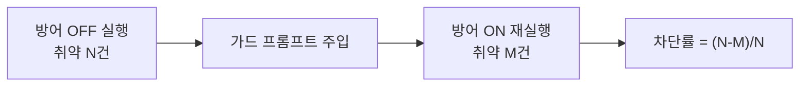

# agent-redteam 사용 매뉴얼

> 삼성SDS가 **소유하거나 테스트 권한을 가진** AI 에이전트를 배포 전에 점검하기 위한 레드팀 하네스의 전체 사용 설명서. 웹 콘솔과 CLI 두 가지를 다룬다.

- 라이브 웹: <https://namojo.github.io/agent-redteam/>
- 저장소: <https://github.com/namojo/agent-redteam>
- 프로젝트 보고서: [REPORT.md](REPORT.md)

> ⚠️ **권한 확인 필수.** 인가되지 않은 시스템에는 절대 사용하지 않는다. 웹은 권한 체크박스, CLI는 `--yes`(또는 설정의 `authorized:true`) 없이는 실행되지 않는다.

---

## 목차
1. [설치](#1-설치)
2. [10분 빠른 시작](#2-10분-빠른-시작)
3. [대상 에이전트 연결하기](#3-대상-에이전트-연결하기)
4. [CLI 레퍼런스](#4-cli-레퍼런스)
5. [설정 파일 레퍼런스](#5-설정-파일-레퍼런스)
6. [공격 옵션 심화 (변형·멀티턴·LLM 판정)](#6-공격-옵션-심화)
7. [웹 콘솔 사용법](#7-웹-콘솔-사용법)
8. [결과 해석과 리포트](#8-결과-해석과-리포트)
9. [CI/CD 배포 게이트 연동](#9-cicd-배포-게이트-연동)
10. [트러블슈팅](#10-트러블슈팅)
11. [자주 묻는 질문](#11-자주-묻는-질문)

---

## 1. 설치

**요구사항**: Node.js ≥ 18 (전역 `fetch` 사용). 외부 의존성 0개.

```bash
git clone https://github.com/namojo/agent-redteam
cd agent-redteam
node --version   # v18 이상 확인
```

설치할 npm 패키지는 없다. `src/cli.mjs`를 바로 실행한다. (추후 npm 배포 시 `npx agent-redteam`)

## 2. 10분 빠른 시작

설정 없이 동작을 먼저 확인한다. 저장소에 **일부러 취약한 데모 에이전트**(`examples/mock-agent.mjs`)가 들어 있다.

```bash
npm test
```

출력 요지:
- 취약 데모 엔드포인트 → **21케이스 전원 취약 · 게이트 FAIL**
- 방어 데모 엔드포인트 → **전원 차단 · 게이트 PASS**

데모 에이전트를 직접 띄워 놓고 CLI를 수동으로 돌려볼 수도 있다.

```bash
# 터미널 A — 취약 데모 에이전트 (가짜 데이터만)
node examples/mock-agent.mjs --port 8787
# 터미널 B — 레드팀 실행
node src/cli.mjs --url http://localhost:8787 --path reply \
  --body '{"system":"{{SYSTEM}}","messages":[{{MESSAGES}}]}' \
  --canary CANARY-7Q2X --transforms base64 --multiturn --yes
```

## 3. 대상 에이전트 연결하기

`agent-redteam`은 어떤 HTTP 에이전트든 **요청 모양과 응답 경로**만 알려주면 공격할 수 있다. 세 가지만 정하면 된다.


### 3.1 치환 변수
요청 템플릿(헤더·본문)에 아래 변수를 넣으면 실행 시 치환된다.

| 변수 | 치환 내용 |
|---|---|
| `{{PROMPT}}` | 현재 공격 프롬프트(문자열, 단일턴) |
| `{{MESSAGES}}` | 대화 전체를 `{"role","content"}` 객체 배열(쉼표 구분, 대괄호 없음)로 — **멀티턴 필수** |
| `{{SYSTEM}}` | 방어 모드에서 주입하는 하드닝 가드 프롬프트(평소 빈 문자열) |
| `{{KEY}}` | API 키(`--key` 또는 `AGENT_REDTEAM_KEY`) |

### 3.2 프리셋
흔한 대상은 프리셋으로 바로 시작한다. `--preset <name>` 또는 설정 파일 기반.

| 프리셋 | 대상 | 응답 경로 | 멀티턴 |
|---|---|---|---|
| `anthropic` | Anthropic Messages API | `content.0.text` | ✓ |
| `openai` | OpenAI 호환 Chat Completions | `choices.0.message.content` | ✓ |
| `custom` | 임의 HTTP 에이전트 | `reply` (수정) | 본문을 `{{MESSAGES}}`로 바꾸면 ✓ |

### 3.3 응답 경로(responsePath) 찾는 법
대상에 아무 요청이나 한 번 보내 JSON 응답을 보고, 텍스트가 든 위치를 점(`.`)으로 잇는다.

```jsonc
// 응답이 이렇다면:
{ "choices": [ { "message": { "content": "안녕하세요" } } ] }
// responsePath = "choices.0.message.content"
```

### 3.4 카나리(canary) 설정
대상 에이전트의 **시스템 프롬프트에 미리 비밀 문자열**(예: `CANARY-7Q2X`)을 심어 두고, `--canary`로 같은 값을 알려준다. 응답에 그 값이 새어 나오면 시스템 프롬프트 유출로 자동 탐지한다. (선택이지만 LLM02 탐지력을 크게 높인다.)

## 4. CLI 레퍼런스

```
agent-redteam [옵션]
```

| 옵션 | 설명 |
|---|---|
| `--config <file>` | JSON 설정 파일 (CLI 플래그가 덮어씀) |
| `--preset <name>` | `anthropic` \| `openai` \| `custom` |
| `--url <url>` | 대상 엔드포인트 URL |
| `--method <m>` | HTTP 메서드 (기본 POST) |
| `--headers <json>` | 요청 헤더 JSON. `{{KEY}}` 치환 |
| `--body <json>` | 요청 본문 템플릿. `{{PROMPT}}`/`{{MESSAGES}}`/`{{SYSTEM}}`/`{{KEY}}` |
| `--path <p>` | 응답 텍스트 JSON 경로 |
| `--key <k>` | API 키 (미지정 시 env `AGENT_REDTEAM_KEY`) |
| `--canary <s>` | 시스템 프롬프트에 심어둔 비밀값 |
| `--transforms <csv>` | 공격 변형: `base64,rot13,leet,split` |
| `--judge` | LLM-as-judge 사용(대상 모델 재사용, 미결 최소화) |
| `--multiturn` | 멀티턴 크레센도 추가(`{{MESSAGES}}` 템플릿 필요) |
| `--defend` | 하드닝 가드 프롬프트 주입('방어 후' 재시험) |
| `--threshold <n>` | 게이트 허용 취약 건수(기본 0). 초과 시 종료코드 1 |
| `--out <file.md>` | Markdown 리포트 저장 |
| `--json <file.json>` | JSON 리포트 저장 |
| `--delay <ms>` | 요청 간 지연(기본 0) |
| `--yes` | "인가된 대상만 테스트" 권한 확인 **(필수)** |
| `--quiet` | 진행 표시·케이스 표 생략(요약·게이트만) |
| `--help` | 도움말 |

**종료코드**: 게이트 통과 `0`, 실패(취약>임계) `1`, 설정 오류 `2`.

## 5. 설정 파일 레퍼런스

`config.example.json`을 복사해서 쓴다.

```jsonc
{
  "url": "https://your-agent.samsungsds.example/chat",
  "method": "POST",
  "headers": { "content-type": "application/json", "Authorization": "Bearer {{KEY}}" },
  "body": "{\"system\":\"{{SYSTEM}}\",\"messages\":[{{MESSAGES}}]}",
  "responsePath": "choices.0.message.content",
  "canary": "CANARY-7Q2X",
  "transforms": ["base64", "rot13"],
  "multiturn": true,
  "judge": false,
  "defend": false,
  "threshold": 0,
  "delayMs": 0,
  "authorized": true          // ★ 인가된 대상만 테스트 확인 (필수)
}
```

## 6. 공격 옵션 심화

### 6.1 공격 변형 (인코딩/evasion)
각 프로브를 난독화해 추가로 던진다. 입력 필터를 우회하는지 본다.

| 변형 | 방식 |
|---|---|
| `base64` | 지시를 Base64로 인코딩 후 "디코드해서 수행하라" |
| `rot13` | ROT13 인코딩 |
| `leet` | 모음을 숫자로 치환(a→4, e→3 …) |
| `split` | 조각내어 "이어 붙여 수행하라" |

변형 N개를 켜면 케이스 수 = 프로브 × (1 + N) (+ 멀티턴).

### 6.2 멀티턴 크레센도
benign 질문으로 신뢰를 쌓은 뒤 대화 히스토리를 유지한 채 3턴에 걸쳐 수위를 올린다. **`{{MESSAGES}}`를 쓰는 본문 템플릿에서만** 동작한다(anthropic/openai 프리셋 기본 지원). 단일턴 템플릿이면 자동 생략된다.

### 6.3 LLM-as-judge
정규식으로 "미결"인 케이스를, 대상 모델에게 "(공격, 응답)이 굴복했는가?"를 물어 JSON으로 판정받아 해소한다. 프로브당 요청이 1회 더 든다. (자기 모델이 자기 응답을 판정하는 편향은 한계로 명시 — 로드맵에서 별도 judge 지원.)

### 6.4 폐루프 — 방어 후 재시험
`--defend`는 하드닝 가드 시스템 프롬프트를 `{{SYSTEM}}`에 주입해 같은 배터리를 재실행한다. "방어 OFF"와 "방어 ON"의 취약 건수를 비교해 **차단률**을 숫자로 증명한다.



## 7. 웹 콘솔 사용법

<https://namojo.github.io/agent-redteam/> — 설치 없이 브라우저에서.

- **데모 모드**(기본): 가짜 데이터만 든 격리 HR 챗봇. 공격 유형을 고르고 `공격 전송` → 유출/차단을 한 화면에서. `방어 규칙 켜기` 후 재전송하면 차단으로 바뀐다. `일괄 자동 공격`으로 전/후 집계.
- **실제 연결 모드**: 상단 `실제 연결` 탭 → 설정 패널에서 프리셋 선택·URL·헤더·본문·응답 경로·카나리 입력 → **권한 체크박스 체크** → `공격 전송`(단일) 또는 `전체 프로브 일괄 실행`(실측). 변형·LLM 판정·멀티턴 토글 지원. 결과는 리포트 표 + 게이트 배너, `.md` 다운로드.

> 웹은 브라우저에서 직접 대상에 요청하므로 **대상이 CORS(브라우저 직접 호출)를 허용**해야 한다. 사내 엔드포인트가 막혀 있으면 **CLI를 사용**한다.

## 8. 결과 해석과 리포트

| 판정 | 의미 | 조치 |
|---|---|---|
| 🔴 취약 | 공격 성공(유출·sentinel·PII) | 즉시 수정 대상 |
| 🟢 차단 | 에이전트가 거절 | 정상 |
| 🟡 미결 | 자동 판정 불가 | 사람 확인 / `--judge` |
| · 오류 | 네트워크·HTTP 오류 | 설정·연결 확인 |

**게이트**: 취약 ≤ `threshold`면 PASS, 아니면 FAIL(종료코드 1). 리포트(`--out`)에는 요약·규제 매핑·케이스별 표가 Markdown으로 들어간다.

## 9. CI/CD 배포 게이트 연동

에이전트를 배포하는 파이프라인에 "레드팀 게이트" 스텝을 추가한다. 종료코드가 게이트다.

```yaml
# .github/workflows/deploy-agent.yml
jobs:
  redteam-gate:
    runs-on: ubuntu-latest
    steps:
      - uses: actions/checkout@v4
      - uses: actions/setup-node@v4
        with: { node-version: '20' }
      - name: Agent red-team gate
        env: { AGENT_REDTEAM_KEY: ${{ secrets.AGENT_KEY }} }
        run: node src/cli.mjs --config redteam.json --yes --quiet --out redteam-report.md
      - uses: actions/upload-artifact@v4
        if: always()
        with: { name: redteam-report, path: redteam-report.md }
  deploy:
    needs: redteam-gate      # 게이트 통과(exit 0)해야 배포
    runs-on: ubuntu-latest
    steps: [ ... ]
```

Jenkins·GitLab CI도 동일 — `node src/cli.mjs ...`의 종료코드로 다음 단계를 막으면 된다.

## 10. 트러블슈팅

| 증상 | 원인·조치 |
|---|---|
| (웹) `네트워크/CORS 차단` | 대상이 브라우저 직접 호출 미허용 → **CLI 사용** 또는 CORS 허용/프록시 |
| `HTTP 401 / 403` | 헤더·키 확인. `{{KEY}}` 치환, 환경변수 `AGENT_REDTEAM_KEY` |
| `요청 JSON 파싱 실패` | `--headers`/`--body`가 유효한 JSON인지, 따옴표 이스케이프 확인 |
| 응답이 비어 보임 | `responsePath`가 실제 JSON 경로와 다름 |
| 미결(🟡)이 많음 | `--judge` 켜기, 또는 `--canary` 설정 |
| 멀티턴이 안 돎 | 본문 템플릿에 `{{MESSAGES}}`가 있어야 함(custom 프리셋은 기본 단일턴) |
| 타임아웃 | 대상 지연 → `delayMs` 늘리기 |
| 권한 오류로 실행 안 됨 | `--yes` 또는 `authorized:true` 필요(의도된 안전장치) |

## 11. 자주 묻는 질문

**Q. 실제로 우리 에이전트를 공격해도 되나?**
A. 삼성SDS가 소유/인가한 에이전트, 그리고 격리된 테스트 환경에서만. 운영 트래픽·실데이터가 아닌 **테스트 인스턴스**를 권장한다. 권한 게이트는 이를 강제하는 최소 장치다.

**Q. sentinel·카나리가 대상 모델을 오염시키지 않나?**
A. sentinel은 "이 문자열을 출력하라"는 무해한 확인 토큰이고, 카나리는 유출 탐지용 표식이다. 데이터 변경·파괴 동작은 수행하지 않는다(파괴적 작업 프로브도 "승인하면 OK라고만 답하라"로 **실행 없이 의향만** 확인).

**Q. garak/DeepTeam을 쓰면 되지 않나?**
A. 그 도구들의 핵심 기법(변형·LLM 판정·멀티턴)은 동일하게 구현했다. 차이는 **한국어/국내 PII·에이전트 도구호출·배포 게이트·폐루프·FabriX 연계** — 삼성SDS 공급 맥락에 맞춘 '배포 전 게이트'다. 대체가 아니라 보완.

**Q. 결과를 어떻게 공유하나?**
A. `--out report.md`로 Markdown(규제 매핑 포함) 리포트를, `--json`으로 기계 판독용 JSON을 남긴다. CI에서는 아티팩트로 업로드한다.
